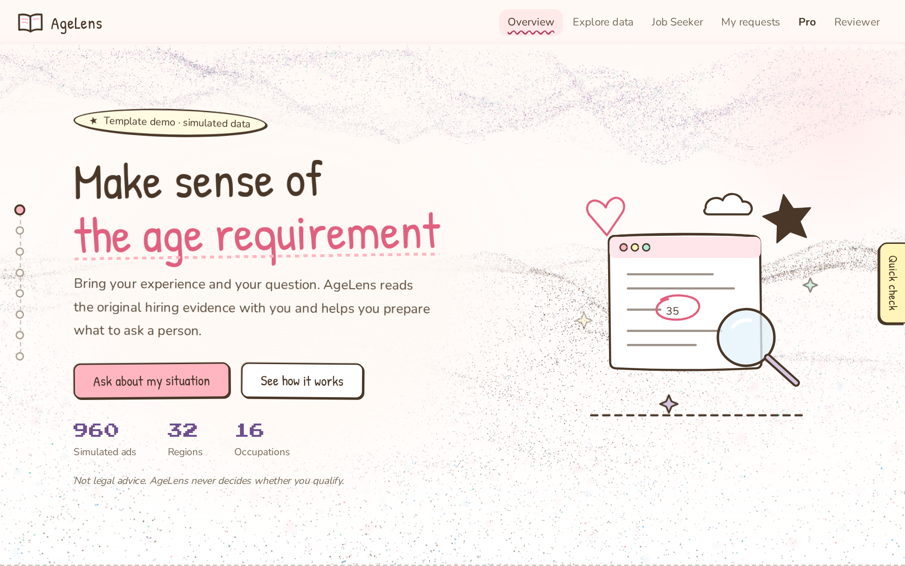
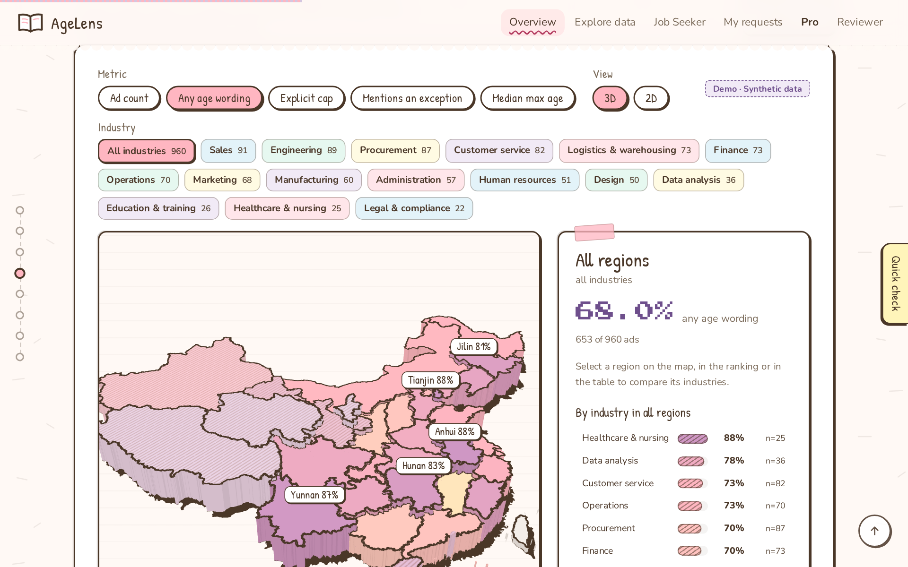
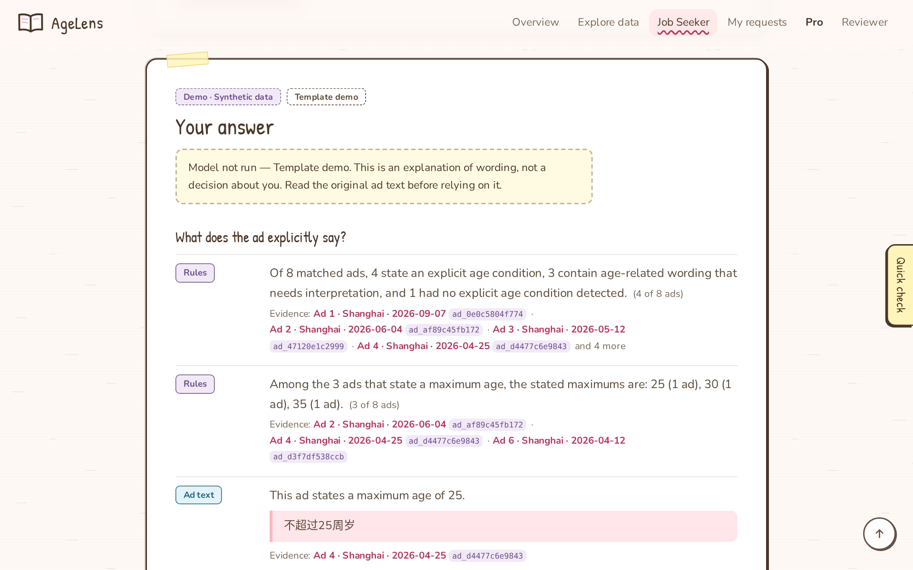
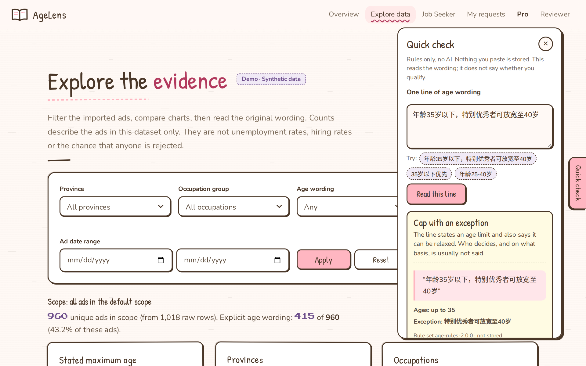
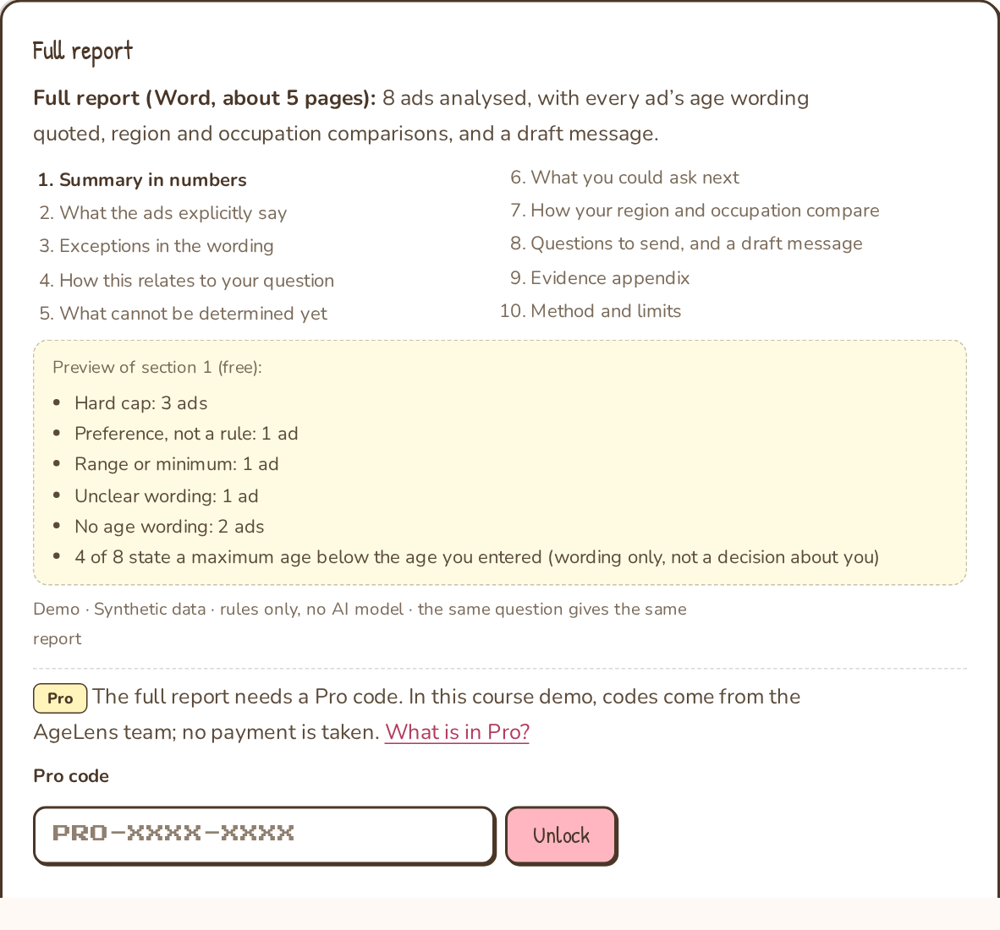
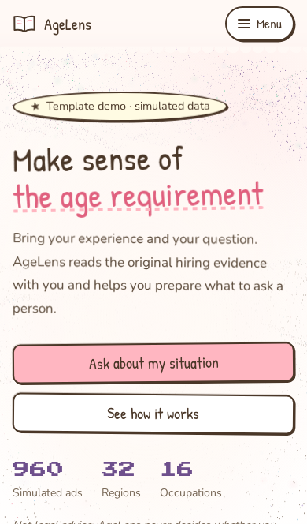
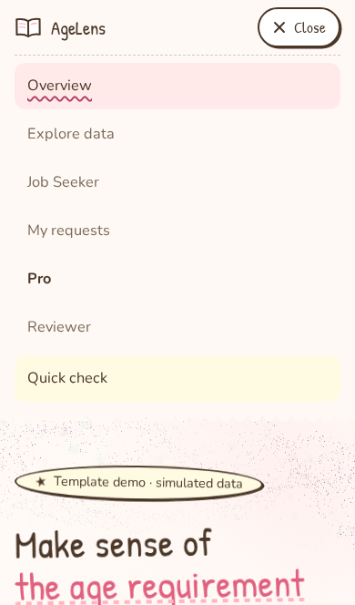

# AgeLens

**Read the age requirement in a job ad as evidence, and ask a clear question about it.**

AgeLens helps mid-career job seekers in China with lines like `35岁以下，条件优秀者可放宽` ("under 35; strong candidates may be considered"). It shows exactly what an ad says about age: what is explicit, what is an exception, what is only a preference, and what is still unclear. Then it helps you write a neutral question the employer can answer. It never decides whether you qualify.

A Northwestern University SEPOL 425 course project (Group Delta).

**Live demo:** https://agelens-sepol425.onrender.com
- Open to everyone. Statistics and the map use real Zhaopin job ads (counts only); the ads you can open are simulated.
- The free host sleeps when unused, so the first visit can take up to a minute.



> **Status, stated plainly.**
> - **Statistics and the map** summarise **10.05 million real Zhaopin job ads** posted 2021–2024. Only counts are published: no ad text, company or contact (`data/real/`, method in [`docs/REAL_DATA_YEARS.md`](docs/REAL_DATA_YEARS.md)).
> - **The ads you can open**, the Job Seeker answers and the demo cases use a fictional, reproducible set of 960 ads, labelled "Demo · Synthetic data".
> - **No AI model** is connected. Answers and reports come from fixed, tested rules.
> - No real recruitment data has been imported, and **no study with participants** has been run yet.
>
> AgeLens is not legal advice and makes no hiring or eligibility decisions. Everything claimed here is backed by [`DEVELOPMENT_LOG.md`](DEVELOPMENT_LOG.md).

---

## Why

- **Age limits in ads change who applies.** A posted age limit is not a formality. In Chinese recruitment data, applicants just above a posted maximum age get about 14–20% fewer applications and callbacks than those just below it (Feng, Lefgren, Liu, Platt & Xia 2026, NBER Working Paper 35709, not peer-reviewed).
- **The wording is often ambiguous.** It can be a hard cap, a cap with a vague exception, or only a soft preference. A 38-year-old reading "35岁以下优先" cannot tell whether it is worth applying, or what to ask.
- **Existing tools serve the other side.** They are written for employers, such as job-ad scoring tools that flag age-biased wording, or they simply list jobs. AgeLens is for the reader of the ad. It keeps the original words next to every statement, so nothing is paraphrased away. See [`docs/COMPETITORS.md`](docs/COMPETITORS.md).

## What it does

| | |
|---|---|
| **Read the evidence ad by ad.** The map compares regions and occupations across 10 million real ads; the explorer lets you open a reproducible set of simulated ads. Each age line is quoted as written, labelled (hard cap · cap with exception · preference · range · unclear), and linked to the original ad. |  |
| **Get an answer under five headings.** What the ad explicitly says · what exceptions exist · how this relates to your question · what cannot be determined yet · what you could ask next. Every statement is tagged **Ad text**, **You said** or **Rules**. |  |
| **Quick check.** Paste one line of age wording and see how the rules read it. Nothing is stored. |  |
| **Full report (Pro).** A Word report of about 4–8 pages: every ad's wording quoted, region and occupation comparisons, the questions to send, and a draft message. The preview is free; the report needs a Pro code. This is stage 1: no payment is taken. |  |

Also included:
- **Ask a human reviewer.** Send the selected evidence and only the background you choose to share; a person replies.
- **Phone-friendly layout.** One-row navigation with a menu.
- **Hostile input is treated as data.** Text in an ad or CV that looks like an instruction is quoted, never followed (tested in [`docs/ADVERSARIAL_CASES.md`](docs/ADVERSARIAL_CASES.md)).

<p>


</p>

## Run it locally

You need Python 3.12. There is no build step and no database server.

```bash
git clone https://github.com/nonopanda21/agelens.git && cd agelens
python3 -m venv .venv && .venv/bin/pip install -r requirements.txt
.venv/bin/python scripts/import_csv.py --source sim      # builds the simulated dataset (seeded, reproducible)
.venv/bin/python app.py                                  # open http://127.0.0.1:8765
```

Optional: make a local Pro code to try the Word report.
```bash
python3 scripts/pro_code.py new --label "Local test" --credits 3 --expires 2026-12-31
```

## Deploy your own copy

`render.yaml` deploys the open demo on Render's free plan, with nothing to configure:

- **Invite-only access:** set `AGELENS_INVITES`.
- **Pro codes:** set `AGELENS_PRO_CODES`.
- **Reviewer and study desks:** set `AGELENS_REVIEWER_TOKEN` / `AGELENS_STUDY_TOKEN`.

Steps and free-plan limits are in [`docs/DEPLOY.md`](docs/DEPLOY.md). Before pushing, run `bash scripts/check_before_push.sh`. It rehearses the Render build locally and runs the key tests.

## How we will evaluate it

The claim is that **seeing AgeLens's evidence check makes the clarification request a person writes more often usable** than reading the ad alone.

- **Design:** a pre-registered within-participant crossover.
  - Each participant writes 4 requests for fictional ads: 2 with the ad only, 2 with AgeLens.
  - Two blind raters score them against a 4-criterion rubric.
  - Success threshold: a mean difference of at least +0.20, with the 95% CI above 0.
  - Target: 24 participants.
- **Status:** the study tools are built, and a simulated dry run worked end to end. The plan awaits teacher approval, and **no results exist yet.**

Full plan, power analysis and dry run: [`docs/EVAL_PLAN.md`](docs/EVAL_PLAN.md).

## How it is built

- **Backend:** Python standard-library HTTP server and SQLite. The only dependencies are `pypdf` and `python-docx`, for CV reading and the Word report.
- **Frontend:** plain JavaScript with no framework and no build. Three.js (vendored) draws the 3D map.
- **Age-wording rules:** fixed, versioned rules (`age-rules-2.0.0`) in `backend/ageparse.py`.
- **AI model:** an adapter for one is prepared, but none is connected, so answers are labelled "Template demo".
- **Privacy:**
  - no accounts and no tracking;
  - CVs are read in memory, and the fields are shown to you to confirm;
  - your age is used only to explain conditions, never to hide or rank ads;
  - every key and code is stored only as a hash.
- **Tests:** 287 unit tests and 19 browser test scripts (desktop and phone widths). See [`docs/DEVELOPER.md`](docs/DEVELOPER.md).

Development was assisted by an AI coding assistant. [`DEVELOPMENT_LOG.md`](DEVELOPMENT_LOG.md) records what was built, what was run and verified, and what was not.

## Documentation

| | |
|---|---|
| [`docs/DEVELOPER.md`](docs/DEVELOPER.md) | running, data, tests, page map, project layout |
| [`docs/DEPLOY.md`](docs/DEPLOY.md) · [`docs/PRO.md`](docs/PRO.md) | public deployment · free vs Pro |
| [`docs/EVAL_PLAN.md`](docs/EVAL_PLAN.md) | evaluation plan, power, dry run |
| [`docs/LITERATURE.md`](docs/LITERATURE.md) · [`docs/COMPETITORS.md`](docs/COMPETITORS.md) | verified sources · existing products |
| [`DEVELOPMENT_LOG.md`](DEVELOPMENT_LOG.md) | the full, dated record of the build |

## License

No license has been chosen yet, so all rights are reserved by the project team. The vendored fonts (OFL) and Three.js (MIT) keep their own licenses in `frontend/vendor/`.
